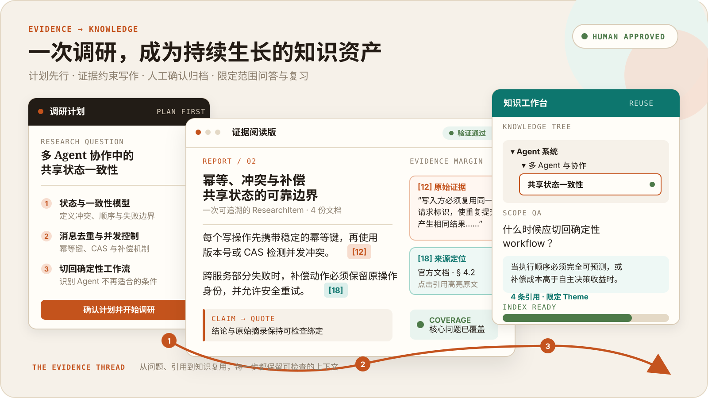

<h1 align="center">Deep Research</h1>

<p align="center">
  <strong>先确认研究计划，再生成可追溯报告，最后沉淀为可问答、可回顾的个人技术知识库。</strong>
</p>

<p align="center">
  Web / 飞书 · 证据追溯 · 人工确认 · 知识复用
</p>

<p align="center">
  <a href="#使用流程">使用流程</a> ·
  <a href="#核心设计">核心设计</a> ·
  <a href="#真实运行">真实运行</a> ·
  <a href="#快速开始">快速开始</a> ·
  <a href="#使用范围与边界">使用边界</a>
</p>



<p align="center"><sub>基于当前产品界面与真实工作流绘制，内容为脱敏演示。</sub></p>

Deep Research 面向 AI 与软件技术学习中“检索分散、结论难核验、成果难复用”的问题，将研究规划、多源检索、证据写作和知识管理串成完整流程。报告不只是一次回答，还能在确认归档后用于限定范围的问答与飞书知识卡回顾。

## 使用流程

**提出主题 → 确认计划 → 后台调研 → 阅读报告与证据 → 确认归档 → 范围问答 / 飞书回顾**

Research Studio 用于审阅计划与跟踪任务；Evidence Reader 支持从报告引用回查来源和证据；Knowledge Workspace 按知识库、主题和研究条目组织成果。另支持单 URL 快速简报，默认不进入知识归档。

## 核心设计

- **Agent 协作与计划契约**：基于 LangGraph 的 Main Agent 调用工具或委派仓库分析、知识管理等专用 Agent，KB QA Agent 经渠道路由独立承接问答。Plan-first 将用户确认的结构化计划经完整性校验后提交至后台 Research Job，由 Question Loop 执行默认研究流程。
- **共享材料，按问题收敛**：任务级来源池统一去重抓取、共享正文；各问题独立抽取可回溯的 `Claim + Quote`，根据完成判据、覆盖缺口、比较矩阵与预算决定补查或停止。
- **证据写作与分层核验**：章节模型并行写作，预校验声明进入 Claim Bank，再由 Editorial 串行生成摘要与结论。针对自动互改不稳定收敛，取消默认返修闭环，将支持性核验、章节质量诊断与程序检查分开，最终由用户确认归档。
- **知识正本与索引分离**：Markdown、目录与 manifest 保存报告、证据血缘和知识层级，SQLite 保存任务与会话等运行状态；每个 ResearchItem 建立可重建的 LightRAG 索引，支持知识库、主题或单条研究范围的问答。

查看 [整体架构](./docs/ARCHITECTURE.md)，或从 [研究编排](./backend/research/orchestrator.py)、[证据写作](./backend/research/writer.py) 和 [知识索引](./backend/services/index_service.py) 进入实现。

## 真实运行

在 **2026-09-10 的受控本地快照**中，个人知识库包含 **44 个**状态为 `active` 的 ResearchItem，其独立索引 **44/44** 均为 `ready`。

同日，以“多 Agent 并行协作中的共享状态一致性”为题，完成一次受控端到端验证：

| 环节 | 本次样本结果 |
| --- | --- |
| 调研与核验 | 产出 4 份 Markdown、11 个来源和 83 条 Evidence；Quality Gate 与 Validation 通过 |
| 归档与复用 | 人工确认归档、独立索引就绪；Theme 范围问答返回答案及 4 条引用 |
| 飞书知识卡 | 2 次受控真实发送，验证轮换选材与成功后游标推进 |

以上是从内部运行账本提取的脱敏摘要。原始 Job 产物、Provider 诊断和消息标识不随公开候选快照分发。这次样本验证了功能链路，不代表长期稳定性；飞书发送为受控触发，尚未验证自然时间窗调度。

## 确定性证据演示

下面的演示使用完全合成的 Plan、Chunk、Evidence 和冻结写作结果，实际执行 Evidence 追溯、章节研究清单、上下文选择、引用结构校验和 Citation Reader 映射；它不读取 `.env`，不调用模型或网络，也不写数据库与知识库：

```bash
PYTHONDONTWRITEBYTECODE=1 .venv/bin/python scripts/demo_public_evidence_pipeline.py
```

输出中的 `input_sha256`、`packet_hash` 和 `output_sha256` 用于复核相同输入是否得到相同结果。该演示只证明确定性血缘与引用结构成立，不证明正文的完整语义都被引用支持。真实报告还会经过模型式 Claim Entailment（声明支撑判断）、Critic（质量审查）和人工阅读；这些判断仍可能漏检，不能把自动 `passed` 当成绝对正确。

## 快速开始

推荐开发环境：**Python 3.12、Node.js 20 与 npm**。

本地优先不等于完全离线：实际调研需要模型、Embedding、搜索或抓取服务，可能产生费用并向相应服务发送所需上下文。请按 [配置说明](./docs/CONFIGURATION.md) 填写本地配置；真实飞书发送与主动推送默认关闭。

### 安装与配置

在仓库根目录执行：

```bash
python3.12 -m venv .venv
.venv/bin/python -m pip install --upgrade pip
.venv/bin/python -m pip install -r requirements.txt

# 仅首次安装时复制；已有配置请勿覆盖
cp .env.example .env
cp frontend/.env.example frontend/.env.local

cd frontend
npm ci
cd ..
```

### 启动

终端一，启动 Backend：

```bash
.venv/bin/python -m uvicorn backend.app:app --host 127.0.0.1 --port 24680
```

终端二，启动 Frontend：

```bash
cd frontend
npm run dev:real
```

访问 `http://127.0.0.1:24681`。新 clone 不包含维护者的个人知识库和运行数据。

CLI、飞书 Worker、Docker 边界与无真实发送验证命令见 [开发指南](./docs/DEV_SETUP.md)。

## 使用范围与边界

当前面向**本地单用户或受控小范围使用**：

- **访问安全**：尚无全局应用访问鉴权，不应将 Backend 或未正确验签的 Webhook 暴露到不可信公网。密钥、个人知识、索引、SQLite、Trace 与日志不属于公共源码。
- **任务与推送**：Research Job 由后台线程执行，不支持从任意阶段自动续跑；Push Scheduler 依附 Backend、默认关闭，尚无持久投递保障和故障接管。
- **验证范围**：尚未完成多实例、多频道并发及长期无人值守验证；进程健康检查不等于业务链路可用。

本仓库公开后仍属于源码展示，不等同于开源授权。除 [GitHub 服务条款](https://docs.github.com/en/site-policy/github-terms/github-terms-of-service) 对公开仓库在 GitHub 服务内查看、使用、展示和 fork 所授予的权利，以及 [第三方组件](./THIRD_PARTY_NOTICES.md) 各自的许可证外，当前未另行授予修改或再分发 Deep Research 项目代码的许可。首次公开前仍须完成候选仓库全部 Git 历史、分支、标签和 Actions 日志的敏感信息复核。

## 文档

[架构](./docs/ARCHITECTURE.md) · [开发](./docs/DEV_SETUP.md) · [配置](./docs/CONFIGURATION.md) · [评测方法](./docs/EVALUATION.md) · [第三方声明](./THIRD_PARTY_NOTICES.md)
