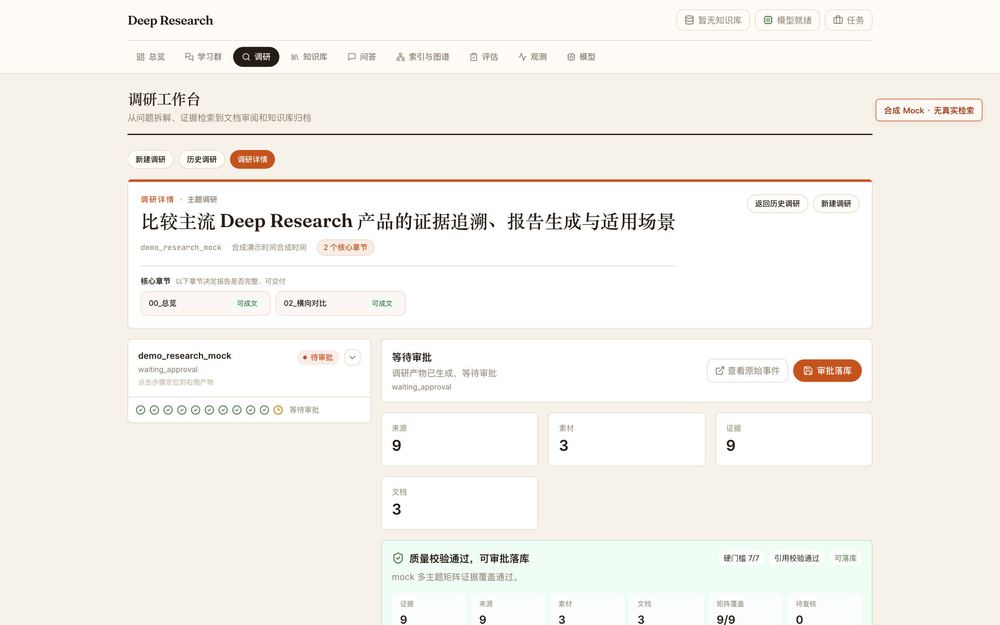
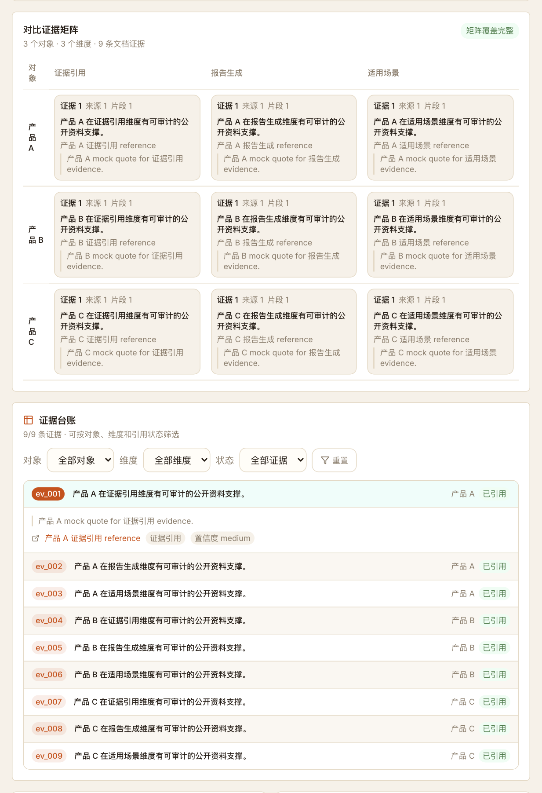
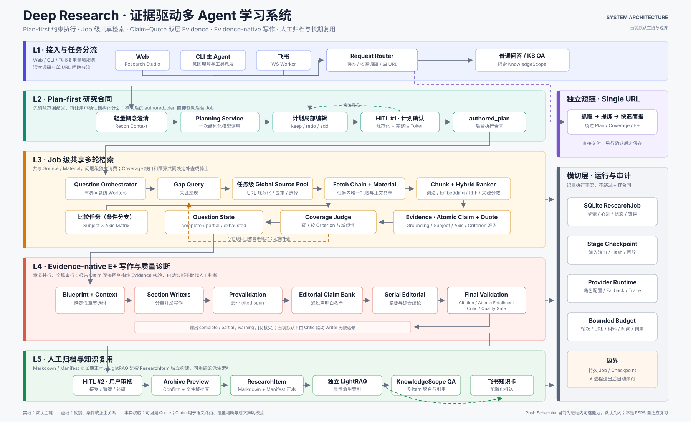

# Deep Research

**以证据为核心的个人深度调研与知识复用系统**

先确认研究计划，再围绕问题检索、抽取和验收 Evidence；报告中的引用可以回到原始片段，确认后的成果继续进入个人知识库、范围问答与飞书回顾。

个人独立开发 · `Python 3.12` · `FastAPI` · `LangGraph` · `React` · `TypeScript` · `LightRAG` · `SQLite`

[产品闭环](#产品闭环) · [架构与关键机制](#架构与关键机制) · [验证证据](#验证证据) · [快速开始](#快速开始) · [文档地图](#文档地图)



> 当前 Frontend 的脱敏截图，使用合成 Mock 数据生成；它展示真实交互和信息结构，不冒充一次外部检索结果。

## 产品闭环

```text
提出研究主题
  -> 审阅并确认研究计划
  -> 按问题检索、抓取、抽取 Evidence
  -> 检查问题与标准是否得到足够支持
  -> 按章节组织证据并生成报告
  -> 核验引用、声明支持性与整体质量
  -> 人工确认归档
  -> 按知识库 / Theme / ResearchItem 问答与回顾
```

这条链路刻意把“找到资料”“形成结论”和“是否值得归档”分开。研究阶段保留来源、Chunk、Quote、Evidence 和问题覆盖；启用 Research Audit 后还会旁路记录模型调用血缘。写作阶段只消费已经准入并分配到对应章节的 Evidence；最终是否进入长期知识库仍由用户确认。

调研工作台把计划、问题闭环、对比矩阵、证据台账、报告和质量结果放在同一任务视图中。Evidence Reader 可以从正文引用回查 Evidence 与来源；比较型研究同时保留对象 × 维度的覆盖矩阵。计划确认界面与完整执行链见[研究管线](docs/RESEARCH_PIPELINE.md)。



## 架构与关键机制



| 层次 | 当前职责 |
| --- | --- |
| Plan First 与 HITL | Planner 生成结构化研究计划；用户确认后才创建 Research Job，避免系统在目标未对齐时直接长跑 |
| Question Loop | 以研究问题为执行单元，共享任务级来源池与抓取正文；根据 Coverage（覆盖判断）缺口决定继续检索或停止 |
| Evidence Contract | Evidence 同时保存可概括的 `atomic_claim` 与来自 Chunk 的 `Quote`；准入、适用问题和覆盖标准保持可追溯 |
| Evidence-native E+ Writer（证据直写） | 确定性 Context Manager 按章节、问题、标准、主体和比较维度组织 Evidence；章节并行写作，Editorial（统稿）只组合已验证的章节声明 |
| Validation 与 Quality Gate | 程序检查引用结构，模型检查 cited span 与 Evidence 的支持关系，Critic 诊断报告质量；`[待核实]` 是人工提示，不替代最终阅读 |
| Knowledge Lifecycle | 用户确认后原子归档为 ResearchItem；Markdown 与 manifest 是知识正本，每个 ResearchItem 建立可重建的独立 LightRAG 索引 |
| Scope QA 与回顾 | KnowledgeScope 可以限定到知识库、Theme 或单个 ResearchItem；同一范围也可用于飞书知识卡轮换 |
| Audit 与 Replay | Research Audit 默认关闭；启用后 checkpoint 与 model call 可交叉定位，artifact 和 parse event 保留关联引用；单次调用可在冻结输入上隔离回放，不重跑搜索或写正式状态 |

当前默认写作主链不依赖 Finding 文本。研究阶段完成证据准入和 Coverage，写作阶段直接消费结构化 Evidence；这样减少一个模型中间表示，同时保留引用、验证与人工确认边界。完整流程见[研究管线](docs/RESEARCH_PIPELINE.md)。

知识正本、索引与范围问答的关系见[知识生命周期](docs/KNOWLEDGE_LIFECYCLE.md)，checkpoint 和隔离回放边界见[可观测性与回放](docs/OBSERVABILITY_AND_REPLAY.md)。

## 验证证据

以下结果均绑定到明确日期和样本，详细口径、限制和不可外推边界见[公开验证证据摘要](docs/VALIDATION_EVIDENCE.md)。

| 验证 | 结果摘要 | 能证明什么 |
| --- | --- | --- |
| 五类 Deep Research 全链路 | 修复通用 Planner 合同问题后完成 5 / 5；247 个带引用声明中 Validator 判定 231 个受支持 | E+ 能覆盖五类研究请求并完成最终引用核验；93.52% 是模型判定，不是人工真值 |
| 最终报告人工复核 | 2 篇可直接交付，2 篇可用但需保留来源提醒，1 篇为明确披露缺口的阶段性报告 | 自动 Gate 5 / 5 不等于五篇质量完全相同 |
| 最小完整系统 smoke | 4 份 Markdown、11 个来源、83 条 Evidence；归档、独立索引、Theme QA 与两次受控知识卡发送完成 | 调研结果可以进入知识复用闭环；不证明长期无人值守可靠性 |
| 审计与回放验收 | 18 个聚焦审计测试与 398 个相关回归通过 | checkpoint 与 model call 可交叉定位，生产 parser 可在冻结输入上隔离回放 |
| 代码与零凭证演示验收 | 完整非 live Python 1396 passed / 6 skipped；独立作品快照 Python 329 passed；Frontend 62 / 62 tests | 首份冻结快照的代码、测试、容器与零凭证 demo 均通过；本轮内容更新后需重新验收 |

五类全链路没有运行正式 Holdout。自动语义验证可能漏检或偏严，未引用的分析也不因此自动成为事实；本项目把引用回查、透明 marker 和人工确认保留在最终交付链上。

## 零凭证演示

仓库提供一条完全合成、确定性的 Evidence 演示。它复用正式的章节研究清单、Context Manager 和引用结构校验，并用演示专用映射展示来源与 Evidence 的关系；它不读取 `.env`，不调用模型或网络，也不写数据库与知识库：

```bash
PYTHONDONTWRITEBYTECODE=1 .venv/bin/python scripts/demo_public_evidence_pipeline.py
```

输出会记录 `input_sha256`、`packet_hash` 和 `output_sha256`。相同输入应得到相同结果；这证明 Evidence 血缘和引用结构可重复，不证明合成正文之外的事实正确性。

## 快速开始

需要 Python 3.12、Node.js 20 和 npm。

```bash
git clone https://github.com/xingchen1573/traceable-deep-research.git
cd traceable-deep-research

python3.12 -m venv .venv
.venv/bin/python -m pip install --upgrade pip
.venv/bin/python -m pip install -r requirements.txt

cp .env.example .env
cp frontend/.env.example frontend/.env.local

cd frontend
npm ci
cd ..
```

启动 Backend：

```bash
.venv/bin/python -m uvicorn backend.app:app --host 127.0.0.1 --port 24680
```

另开终端启动 Frontend：

```bash
cd frontend
npm run dev:real
```

访问 <http://127.0.0.1:24681>。真实调研还需要自行配置模型、Embedding、搜索或抓取服务；可能产生费用，并向相应服务发送完成任务所需的上下文。配置项与默认关闭的外部写入见[配置说明](docs/CONFIGURATION.md)。

## 文档地图

- [系统架构](docs/ARCHITECTURE.md)：运行组件、依赖方向、进程与状态边界
- [研究管线](docs/RESEARCH_PIPELINE.md)：从计划、Question Loop、Evidence 到 E+ 写作与最终核验
- [知识生命周期](docs/KNOWLEDGE_LIFECYCLE.md)：ResearchItem、原子归档、独立索引、Scope QA 与回顾
- [可观测性与回放](docs/OBSERVABILITY_AND_REPLAY.md)：事件、checkpoint、artifact、lineage 与隔离 replay
- [公开验证证据](docs/VALIDATION_EVIDENCE.md)：全链路、完整系统 smoke、审计与 Public 候选的限定结果
- [评测方法](docs/EVALUATION.md)：测试层次、副作用、基线和发布判据
- [开发指南](docs/DEV_SETUP.md)与[配置说明](docs/CONFIGURATION.md)：安装、运行和外部依赖
- [第三方声明](THIRD_PARTY_NOTICES.md)：随仓库分发的第三方组件与许可证

## 当前边界

- 当前适合本地单用户或受控小范围使用；Backend 没有全局应用访问鉴权，不应直接暴露到不可信公网。
- Research Job 仍由进程内后台线程执行；checkpoint 支持审计和局部回放，但不等于进程退出后可以从任意阶段自动续跑。
- Scheduler 依附 Backend 且默认关闭，没有独立 lease、可靠 outbox 或多实例故障接管。
- 新 clone 不包含维护者的知识库、索引、运行日志、模型调用记录或外部服务凭证。
