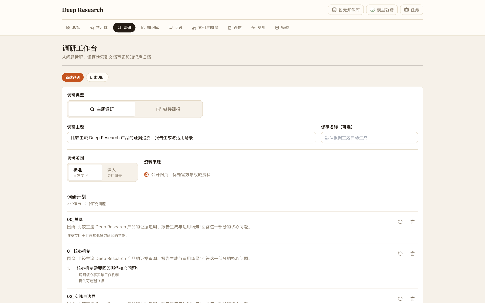

# Deep Research 调研管线

> 状态：`current`
>
> 创建日期：2026-09-18
>
> 最后核对日期：2026-09-18
>
> 当前事实来源：`backend/services/research_planning_service.py`、`backend/services/research_service.py`、`backend/research/orchestrator.py`、`backend/research/evidence.py`、`backend/research/coverage.py`、`backend/research/evidence_native.py`、`backend/research/writer.py`、`backend/research/quality.py`、`backend/research/audit.py` 及相关测试
>
> 替代文档或归档去向：无

## 1. 文档职责

本文解释当前多源 Deep Research 如何把一个经过确认的研究请求转化为可审阅报告，重点说明每个阶段的输入、判断主体、输出、失败边界和可恢复范围。

本文只描述公开 `question_loop` 多源调研与默认 `evidence_native_eplus`（下文简称 E+）写作路径。单链接简报是独立流程；旧 Finding 写作仍存在于兼容代码中，但不是本文主线。系统组件和状态正本见 [ARCHITECTURE.md](./ARCHITECTURE.md)，测试、冻结回放和人工验收层次见 [EVALUATION.md](./EVALUATION.md)。

这条管线遵循一个核心约束：**检索阶段决定“目前有哪些可追溯证据，以及研究问题回答到什么程度”；写作阶段只能在这些证据和已记录缺口内组织表达，不能把写作本身当作新的事实发现。**

## 2. 一条主线

图中的 `P` 表示确定性程序，`M` 表示模型判断，`H` 表示人工决策。

```text
用户请求
  |
  v
[M] 概念核验与研究计划草拟
  |
[P] 计划规范化、签名和结构校验
  |
[H] 用户确认研究范围
  |
  v
Research Plan
  |
[P] 建立 Question State，编译初始查询
  |
  v
Question Loop ---------------------------------------------------+
  |                                                              |
  +-> 来源发现 -> 抓取 -> Chunk 生成/选择                         |
  |                    |                                         |
  |                    v                                         |
  |                [M] Evidence 抽取                              |
  |                    |                                         |
  |                [P] Evidence 准入、Quote 定位、去重/聚类       |
  |                    |                                         |
  |                [M] Coverage Judge                             |
  |                    |                                         |
  |                [P] hard Criterion、来源、边界和比较单元检查  |
  |                    |                                         |
  |        sufficient +------------------------------------------+
  |                    |
  |        blocking gap -> 生成定向补检索 -> 下一轮（受预算限制）-+
  v
最终 Question State + Accepted Evidence + Coverage/Gap
  |
[P] Section Research Manifest（代码兼容名：Evidence-native Blueprint）
  |
[P] 每章节构建 Evidence Context Packet
  |
  v
[M] 并行 Section Writer
  |
[P] 引用标记规范化，形成 cited-span Claim Ledger
  |
[P+M] 章节 Prevalidation
  |
[P] Editorial Claim Bank
  |
[M] 串行 Editorial（标题、执行摘要、结论）
  |
[P] 组装最终报告
  |
[P+M] Citation / Final Entailment / Critic / Quality Gate
  |
[H] 用户审批
  |
  v
ResearchItem 归档与独立索引
```

Research Plan 决定“要回答什么”；Question Loop 产生“现有材料能够支持什么”；Section Research Manifest 把最终研究账本转成章节读取清单；Context Manager 决定“一个章节在本次模型调用中看到哪些已准入证据”；Writer 与 Editorial 负责表达；最终验证和人工审批决定是否交付、是否归档。

## 3. Plan First：先冻结研究合同

正式主题调研不会从一句请求直接创建 Job。规划服务先做轻量概念核验和结构化计划，计划至少包含章节、问题，以及问题的回答合同。一个 Question 可以只有一个 Criterion；只有当用户确认的同一问题确实包含多个独立义务时，才需要多个 Criterion。`hard` 表示完成基本交付必须满足，`soft`/`optional` 表示有价值但不应把整份研究判为未完成的补充范围。



> 这是当前 Frontend 的真实计划确认界面，内容为合成 Mock；它用于展示交互和信息结构，不代表一次外部检索结果。

这里的职责分为三层：

| 层 | 当前职责 |
| --- | --- |
| 模型 | 识别概念歧义，草拟中性的章节、Question 和 Criterion；不得把候选答案写进研究合同 |
| 程序 | 规范化结构，校验比较对象和维度，生成内容绑定的 `plan_id` 与签名凭证，并在创建 Job 前验证请求与计划一致 |
| 人工 | 确认研究范围、问题粒度和比较边界；确认的是计划，不是模型预写的答案 |

Job 执行时复用已确认计划，只做幂等规范化，不再调用 Planner 生成另一份计划。概念核验不可用、签名不匹配、计划为空或没有可执行 Question 时，流程在创建 Job 前停止。内部评测可以显式使用系统生成计划，但不能把这条兼容能力描述成正式入口默认行为。

相关实现位于 [`backend/services/research_planning_service.py`](../backend/services/research_planning_service.py)、[`backend/services/research_plan_store.py`](../backend/services/research_plan_store.py) 和 [`backend/services/research_service.py`](../backend/services/research_service.py)。

## 4. Question Loop：按问题积累证据，而不是按章节一次写完

计划被转换为一组 `ResearchQuestionState`。每个状态保存 Question、所在 Section、Criterion ledger、来源要求、比较单元、已尝试查询、Accepted/Rejected Evidence、Coverage、Gap、预算和停止原因。**执行原子是 Question，不是 Section。** 活跃问题可以并行发现来源，也可以在共享来源池中按波次抓取，再分别消费与自己相关的材料；因此流程不是“完成第一章检索后再开始第二章”。

一次常规轮次可以概括为：

```text
Question State + 当前 Gap
  -> 编译本轮查询
  -> 多问题并行发现候选来源
  -> 全局来源池去重、排序和限额选择
  -> 抓取正文，写入 Job Material Store
  -> 各 Question 选择相关 Chunk
  -> 各 Question 独立抽取 Evidence
  -> 准入、Coverage、停止或生成下一轮 Gap Action
```

共享来源池避免多个 Question 重复抓取同一 URL，但材料消费仍保持 Question 作用域：同一来源可以服务多个问题，不能因为被一个问题首先发现就只属于那个问题。比较研究还会维护 `subject × comparison axis` 的 Required Cell，未完成的 Cell 继续产生有界的定向查询。

停止条件由程序统一执行：Coverage 充分、安全检查阻断、连续两轮没有新 Evidence cluster、轮数/材料/URL/模型调用/时间预算耗尽，或比较单元已经完成。预算耗尽并不把一个部分回答伪装成完整回答；Question State 会保留 `complete`、`partial` 或 `uncovered` 的读者语义以及具体停止原因。

主要编排实现在 [`backend/research/orchestrator.py`](../backend/research/orchestrator.py)，生产装配位于 [`backend/services/research_service.py`](../backend/services/research_service.py)。

## 5. Chunk 与 Evidence：候选正文不等于可引用事实

抓取后的正文会被清洗、切分和排序。Chunk 是保留上下文的候选片段；Evidence 是模型从 Chunk 中抽出的原子化、可定位声明。一个 Chunk 可以包含零条、一条或多条 Evidence，模型抽取结果至少要把声明、原文 Quote、`chunk_id`、来源和所属 Question 带回后续准入。

程序随后执行 Evidence Admission：

- 清理噪声并验证必需字段；
- 确认 Quote 能在指定 Chunk 原文中精确定位，记录起止位置；
- 校验来源 URL、实体相关性、Question/Section、Criterion、主体与比较维度；
- 计算来源类型、权威性、适用范围、直接性、立场和证据分数；
- 将相同来源的近重复 Evidence 合并，将不同来源的相似声明放入同一个 `claim_cluster_id`；
- 不满足合同的 Evidence 进入 quarantine，并保留拒绝原因。

Evidence 的 `atomic_claim` 是压缩索引，`Quote` 才是事实权威。后续 Coverage 和 Writer 在两者范围不一致时必须采用 Quote 能支持的更窄表述。系统不会在抽取失败后把 Chunk 截一段文字伪装成 Evidence；模型成功返回空数组表示这批材料没有形成可准入 Evidence，而调用异常或不可解析结果在有界重试耗尽后按抽取失败处理。

程序还可以从 `support_relation`、`target_fit`、词面范围和语义相似度之间检测冲突信号。只有存在这类冲突且语义仲裁启用时，才调用模型做额外仲裁；没有冲突的 Evidence 不增加这次调用。仲裁不可用时，冲突 Evidence 会保守降级为 inference support，语义无关项则被隔离，不能以一次失败的仲裁提升为直接事实。

Evidence 清理、准入和聚类位于 [`backend/research/evidence.py`](../backend/research/evidence.py)。

## 6. Coverage：判断问题是否已能回答

每轮 Evidence 准入后，Coverage Judge 在同一次模型调用中读取：

- 当前 Question 及其回答合同；
- 每个 Criterion 的级别与描述；
- 代表性 Evidence 的 `atomic_claim` 和原始 Quote；
- Criterion 候选 Evidence 分组和未分配 Evidence。

模型为每个 Criterion 返回 `covered / partial / uncovered`、理由和实际采用的 `supporting_evidence_ids`，并给出问题级 `answer_status` 与缺失事实。程序只接受当前 Evidence registry 中存在的 ID，再把确认绑定写回 `Question State.criteria[].evidence_ids`。候选分组只是给 Judge 的输入；确认绑定才是下游清单和 Context 裁剪的依据。模型明确返回空绑定时，系统不会把整组候选重新冒充为确认支持。

程序把语义判断与可计算门槛合并：hard Criterion 必须 covered；Evidence 必须能定位原文；明确要求来源分散时检查独立来源；需要限制或反例的问题记录 boundary Evidence；比较请求检查 Required Cell。来源类型偏好和 soft/optional 缺口通常作为 advisory，不会单独让核心回答失败。

如果存在阻断缺口，Orchestrator 根据具体 `missing_fact`、Criterion、来源或比较单元生成下一轮查询，而不是笼统地“再搜一些”。流程受原 Question budget 约束；报告编排前还允许一次针对 `semantic_coverage`、`evidence_floor` 或 `source_floor` 阻断缺口的有界 reportability rescue。比较任务有独立硬预算时不会绕过该预算增加 rescue。

Coverage 模型不可用时，已有 Evidence 不会自动升级为完整语义回答，读者状态保守显示为 partial。为兼容既有停止语义，只要确定性 Evidence、来源和比较门槛已经满足，控制层仍可能把该轮视为 sufficient 并正常结束；否则按缺口或预算继续。最终语义验证不可用则采用更严格的失败关闭，见第 10 节。

确定性 Coverage gate 位于 [`backend/research/coverage.py`](../backend/research/coverage.py)，模型 Judge 的输入与结果归一化位于 [`backend/services/research_service.py`](../backend/services/research_service.py)。

## 7. Section Research Manifest：把研究账本变成章节清单

Question Loop 结束后已经得到最终账本：

```text
Section
  -> Question
     -> Criterion status + confirmed Evidence IDs
     -> Coverage / Gap / Source state
     -> Comparison Cell state
```

写作前仍需要一个章节级读取结构。本文称它为 **Section Research Manifest（章节研究清单）**；当前源码和持久化字段为了兼容仍使用 `build_evidence_native_blueprint()`、`report_blueprint` 和 `evidence_native_blueprint`。

Manifest 不重新搜索，也不重新判断 Quote 是否支持 Criterion。它将已确认计划和最终 Question State 投影为：

- 章节标题、目的、呈现方式和章节边界；
- 本章包含的 Question 与 Criterion 状态；
- 本章可用的 Evidence ID 和已知缺口；
- 来源下限与 Required Comparison Cell 的现有状态；
- `ready / limited / empty` 的可写性汇总；
- 报告级 `complete_report / partial_report` 结构摘要。

`ready` 表示现有研究合同完整，`limited` 表示存在可交付材料但 hard/source/comparison 合同仍有缺口，`empty` 表示没有可引用 Evidence。`empty` 章节不会调用 Writer；核心章节为空会让报告保持 partial，并在质量门阻止按完整报告批准。

这层的价值是把问题级结果稳定地分发到章节写作，并留下可审计快照，而不是再造一套与 Coverage 竞争的“充分性判断”。实现位于 [`backend/research/evidence_native.py`](../backend/research/evidence_native.py)。

## 8. Context Manager：确定一个章节实际能看到什么

Evidence Context Manager 先按 Section 及其 Question ID 选出候选 Evidence，再使用以下事实组键组织材料：

```text
Question + Subject + Comparison Axis + claim_cluster_id
```

这个分组表示“同一问题下、同一主体和比较维度、表达同一事实簇的 Evidence”。它不会生成新结论，也不会把几条 Evidence 改写成一个新 Finding。Writer 得到的是扁平 `claim_clusters` 数组，每个 cluster 保留自己的 `synthesis_boundary_id`、Criterion、立场、来源和 Evidence 原文。下面保留多个 Criterion、cluster、来源和 Evidence，以展示真实嵌套关系；为便于阅读，仅省略版本/hash 和重复的审计字段：

```json
{
  "section": {
    "section_id": "sec_example",
    "title": "示例章节",
    "evidence_ids": ["ev_001", "ev_002", "ev_003"]
  },
  "question_states": [
    {
      "question_id": "q_example",
      "question": "示例对象具备哪些能力和限制？",
      "criteria": [
        {"criterion_id": "criterion_capability", "level": "hard", "status": "covered"},
        {"criterion_id": "criterion_limit", "level": "hard", "status": "covered"}
      ]
    }
  ],
  "allowed_evidence_ids": ["ev_001", "ev_002", "ev_003"],
  "claim_clusters": [
    {
      "synthesis_boundary_id": "boundary_capability",
      "question_id": "q_example",
      "criterion_ids": ["criterion_capability"],
      "subject": "对象甲",
      "comparison_axis": "能力",
      "claim_cluster_id": "cluster_capability",
      "stances": ["support"],
      "evidence": [
        {
          "id": "ev_001",
          "atomic_claim": "对象甲支持能力 A",
          "quote": "原始来源中可以逐字定位的短句 A",
          "source_url": "https://example.org/source-a"
        },
        {
          "id": "ev_002",
          "atomic_claim": "对象甲支持能力 A",
          "quote": "另一来源中可以逐字定位的短句 B",
          "source_url": "https://example.net/source-b"
        }
      ]
    },
    {
      "synthesis_boundary_id": "boundary_limit",
      "question_id": "q_example",
      "criterion_ids": ["criterion_limit"],
      "subject": "对象甲",
      "comparison_axis": "限制",
      "claim_cluster_id": "cluster_limit",
      "stances": ["limitation"],
      "evidence": [
        {
          "id": "ev_003",
          "atomic_claim": "能力 A 受条件 C 限制",
          "quote": "来源明确说明能力 A 仅在条件 C 下适用",
          "source_url": "https://example.edu/source-c"
        }
      ]
    }
  ]
}
```

正常容量下，本章全部可引用候选 Evidence 都会进入 Packet；Context Manager 不是默认摘要器。只有 Packet 超出配置的输入预算时才进行确定性裁剪，优先级依次是：

1. 已确认绑定到 hard Criterion 的事实簇广度；
2. 带主体或比较维度的 Comparison Cell 广度；
3. 冲突、限制及其同簇支持材料；
4. 每个事实簇至少一个代表，并优先新增来源；
5. 在剩余容量中按来源分散补充深度材料。

被裁剪 ID、原因、来源数、事实簇数、比较单元和 Criterion 选择结果都会进入 diagnostics；`section.evidence_ids` 与 `allowed_evidence_ids` 始终一致。若章节有可引用 Evidence，但连一条都无法放入预算，程序直接报合同错误，不给 Writer 一个看似正常但空洞的上下文。

## 9. 并行章节、Prevalidation 与 Editorial

### 9.1 Section Writer

非总览、非参考索引的可写章节并行执行。模型看到用户请求、当前章节清单、全报告标题骨架和本章 Evidence Context Packet，只返回一个 JSON `content` 字段。它只能使用 `allowed_evidence_ids`，以 `[[ev_...]]` 将引用绑定到 Evidence 真正支持的最小事实子句。

Writer 的关键边界是：Quote 是事实权威；跨 `synthesis_boundary_id` 形成因果、比较或总括结论必须有明确关系 Evidence；冲突材料要并列保留；材料不足时缩短或明确未知。模型可以在引用事实之后写明确分隔的未引用分析，但这种分析不能引入新的外部事实，也不能让前面的引用看似替整个推断背书。

程序检查 JSON、空正文和 Evidence allowlist。非法 marker 会触发有界修复；过短章节可以基于同一个 Packet 尝试一次扩展。调用耗尽后不生成确定性“兜底文章”。有事实正文却没有合法引用 ledger 的章节会标记为 `missing_required_citations`。

### 9.2 Claim Ledger 与章节 Prevalidation

程序把内部 marker 转成读者可见的数字引用，并同时建立 Claim Ledger。每条 ledger row 区分：

- `cited_span`：引用明确声称支持的最小文本；
- `uncited_analysis_span`：同一原子单元中明确位于引用之后的分析；
- `full_atomic_unit` 和 `claim_context`：用于边界和指代审计；
- `evidence_ids`、claim type、support scope 和 direct/inference Evidence。

章节完成后，Prevalidation 以章节为单位并行运行 Atomic Boundary entailment。确定性代码先拦截非原子声明、未知 Evidence ID 等结构错误；需要语义判断的 cited span 交给模型，并且每条只携带自己引用的 Evidence 子集及 Writer 当时可见的上下文。`claim_context` 只用于主语或指代消解，不能作为补充证据。

Prevalidation 只决定一条章节 Claim 是否可以进入 Editorial Claim Bank，不决定最终 marker 或最终审批。只有 atomic 且判为 `entailed`，或以明确限定语表达的 `reasonable_inference`，才进入 Claim Bank；其余条目保留排除理由。

### 9.3 Editorial

Editorial 必须等待所有章节和 Prevalidation 完成。模型不读取原始 Evidence，也不读取 Finding，只能使用已经冻结的 Section Claim Bank 写标题、执行摘要和综合结论。它可以压缩或重述 `cited_span`，不能新增主体、关系、因果、效果、比较或推荐。

Editorial 使用内容寻址的内部 Claim ID。程序把合法 Claim marker 展开回原 Evidence ID，再渲染为数字引用；未知或泄漏的内部 ID 会触发字段级修复，仍失败的字段置空。Claim Bank 为空时不调用 Editorial 模型，而是显示材料不足说明。

并行章节降低等待时间；串行 Editorial 保证摘要只组合已经过章节 Prevalidation 的内容，而不是在章节尚未完成时凭计划猜测整篇结论。

## 10. Final Validation：以最终组装结果为裁决对象

章节和 Editorial 组装后，`report_document.claim_ledger` 汇集最终可见章节、执行摘要和结论中的 cited span。Final Validation 对这份最终 ledger 重新执行验证，不读取 Prevalidation verdict 作为最终结论：

| 检查 | 主体 | 作用 |
| --- | --- | --- |
| Grounding | 程序 | 确认 Accepted Evidence 的 Quote 均可追溯到 Chunk |
| Citation Validation | 程序 | 检查 ledger 中 Evidence ID 存在、章节引用表存在、数字来源序号有效，且正文不泄漏内部 ID |
| Final Claim Entailment | 程序 + 模型 | 先检查原子性和 ID，再以 strict cited-span profile 判断完整语义是否由指定 Evidence 支持 |
| Critic | 模型 | 评价结构、综合、可读性、信息设计和限制表达；同时看到 Writer 可见的 Evidence 上下文 |
| Report Quality | 程序 | 汇总噪声、fallback、内部 ID 泄漏和 Critic 诊断 |
| Combined Quality Gate | 程序 | 合并上述结果、核心章节完整性、比较缺口和语义复核可用性 |

Critic 分数和建议用于质量诊断与局限性披露，不再驱动多轮自动重写。系统当前采用一次生成、一次最终验证：Final Entailment 判为 unsupported 的 E+ cited span 保留原文并添加 `[待核实]`，不自动删除或改写。marker 表示“验证器发现此处值得人工核对”，不是事实已经纠正，也不保证验证器没有漏检或误报。

marker 在 Citation、Final Entailment、Critic 和 Report Quality 完成后插入，插入后不会再运行一次验证。E+ 中 marker 本身是 advisory，不单独阻止审批；但 Citation 结构失败、语义模型在重试后仍不可用、核心章节为空、Writer fallback 或其他确定性质量失败仍会阻止 `approval_ready`。比较矩阵不完整时报告保持 partial，归档还需要人工明确确认矩阵缺口。

最终验证实现位于 [`backend/research/quality.py`](../backend/research/quality.py)，管线装配和 marker/交付状态处理位于 [`backend/services/research_service.py`](../backend/services/research_service.py)。

## 11. 审批与归档边界

生成完成后 Job 进入 `waiting_approval`，不会自动写入正式知识库。`report_status` 主要反映核心章节是否都产生了正文；比较矩阵启用但未完成时也会被强制设为 `partial_report`。它仍不代表每个 hard Criterion 或来源下限都已覆盖，这些缺口保存在章节 `reportability`、Coverage 和 Matrix 状态中。`quality_gate.approval_ready` 是自动质量门结论，`delivery_status` 是界面使用的交付状态。三者不能互相替代。

当前存在两条需要明确区分的人工入口。旧 `/approve` 会严格复核 `approval_ready`，通过后写入兼容知识集；它不会创建 ResearchItem。新的 `archive-preview` / `archive-confirm` 才会以 preview/confirm 协议写入 ResearchItem，并建立独立索引。新归档默认同样拒绝未通过自动质量门的结果，但处于 `waiting_approval` 时，用户可以显式确认质量警告后继续；原始 Gate 结论、确认标记和时间都会写入归档审计信息。比较矩阵缺口还需要单独确认，不能由质量警告确认代替。

人工可以查看正文、Evidence Reader、Coverage/Gap、Validator reason、Critic 建议和 `[待核实]` 标记。只有 `archive-confirm` 成功后才形成 ResearchItem；Evidence Reader 的 HTML 渲染失败不会反向撤销已经成功的归档，但会留下运行告警。

当前 E+ 关闭的是报告生成后的自动章节返修和 targeted-followup 接口，不是研究阶段的定向补检索。Question Loop 仍会根据 Gap 生成下一轮查询，报告编排前也可以在既有预算规则内执行一次有界 reportability rescue；需要进一步补充时再回到研究合同或受控检索。

## 12. 失败与恢复边界

| 失败位置 | 当前处理 | 可以恢复什么 |
| --- | --- | --- |
| Recon、计划或签名校验 | Job 创建前失败关闭 | 保存的计划草稿可继续审阅；不能从 Markdown 猜回结构化计划 |
| 搜索或抓取局部失败 | 记录 provider attempt/access issue，其他来源可继续 | 同一 Question 在剩余预算内继续定向查询 |
| Evidence 模型合法返回空 | 作为“当前材料没有可准入 Evidence”进入 Coverage | Coverage 可触发下一轮；预算结束后保留 partial/uncovered |
| Evidence 抽取调用重试耗尽 | 抛出结构化可重试错误，不从 Chunk 造 Evidence | 已写出的业务/audit checkpoint 可用于诊断或受控重放 |
| Evidence traceability 不成立 | Writer 前抛出合同错误 | 修复输入后重新进入 E+；不会静默删掉问题 Evidence |
| Section Writer 失败 | 有界重试；仍失败则 Job 失败，不生成模板正文 | 内容寻址匹配的其他章节 checkpoint 可在同一入口重入时复用 |
| Prevalidation semantic review 不可用 | 记录 `validation_unavailable`，该 Claim 不进入 Editorial Claim Bank | 最终 ledger 仍由 Final Validation 独立判断；不复用缺失 verdict |
| Final semantic review 不可用 | 重试后仍记录 `validation_unavailable` 并阻止审批 | 对相同输入重新运行验证；不把确定性猜测升级为语义结论 |
| Audit checkpoint 写入失败 | 审计层 fail-open，返回空路径并让主流程继续 | 不承诺每个失败都一定有完整 checkpoint |
| 进程退出 | SQLite 中仍能查看 Job 状态、结果和产物路径 | 当前没有通用后台队列从任意 checkpoint 自动续跑 |

E+ 的 `section_draft`、`section_prevalidation` 和 `editorial` 使用内容寻址 checkpoint，并会在输入匹配时加载复用；`editorial_claim_bank` 也会保存为审计产物，但当前不会作为缓存重新加载。复用校验覆盖架构、版本、配置、代码版本、Blueprint 输入、Question State、Accepted Evidence、Selected Chunk、阶段输入和输出哈希；任一不匹配都拒绝缓存并重算对应阶段。它提供的是**确定性输入下的阶段复用**，不是跨进程执行引擎。

业务 stage checkpoint、模型调用 trace 和 E+ 内容寻址 checkpoint 解决不同问题：前者记录主链状态，trace 记录 prompt/response、模型调用和 fallback lineage，后者避免完全相同的写作输入重复调用。审计实现位于 [`backend/research/audit.py`](../backend/research/audit.py)。

## 13. 程序、模型与人工的责任边界

| 判断 | 程序 | 模型 | 人工 |
| --- | --- | --- | --- |
| 研究范围是否符合用户意图 | 校验计划结构和签名 | 草拟问题与合同 | 最终确认 |
| Quote 是否真实来自 Chunk | 精确定位并记录 span | 抽取候选 Quote | 可在 Evidence Reader 复查 |
| Evidence 是否能回答 Criterion | 过滤非法绑定、合并门槛 | Coverage 语义判断 | 对关键缺口和误判负责最终复核 |
| 章节看到哪些 Evidence | 确定性 Context Manager | 不参与选择 | 可通过 diagnostics 审计裁剪 |
| 报告如何表达 | 约束 ID、渲染引用和建立 ledger | Writer / Editorial 写作 | 判断可读性和最终可交付性 |
| 引用是否支持完整 cited span | 结构校验 | Entailment 语义判断并返回 reason | 处理 marker、漏检和争议 |
| 是否进入知识库 | 默认拦截未通过 Gate 的归档预览，并记录显式警告确认 | 不批准自身输出 | 确认归档；必要时分别确认质量警告和矩阵缺口 |

模型负责需要语义理解的判断，但不拥有状态转换权；程序负责可重复的结构、预算、追溯和 Gate，但不假装能用关键词完成全部语义核验；人工是归档前的最终决策者。

## 14. 当前限制

- 自动 Gate 通过不等于人工认定整篇文章可直接交付，尤其不能替代来源权威性、覆盖广度和未引用分析质量的复核。
- `[待核实]` 只覆盖 Validator 实际发现的 cited-span 问题，不覆盖漏检，也不检查纯分析句是否“观点优秀”。
- Claim Ledger 在 Writer/Editorial 渲染时建立，Final Validation 读取组装后的最终可见 ledger；它不是另一个从 Markdown 任意重建事实结构的全文解析器。
- 默认大 Context 上限通常不会触发裁剪，因此裁剪优先级不能被描述成每次都对 Evidence 做摘要或精选。
- Job、checkpoint 和 trace 提供审计与受控复验基础，但当前没有 durable queue 或任意阶段自动续跑。
- 真实模型、搜索、抓取和来源质量会随环境变化。如何把一次运行提升为可复核基线，应遵循 [EVALUATION.md](./EVALUATION.md)，不能只看单一 `passed` 字段。
